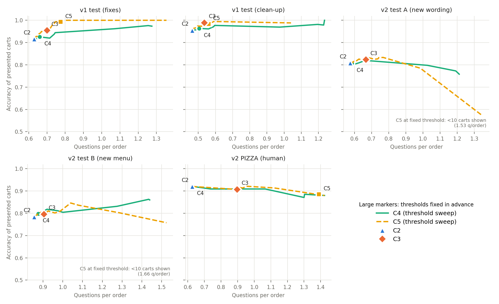

# Section 7 results for the runs executed (2026-11-18/19)

Generated by `section7_tables.py` from the turn traces. Metric definitions follow report Section 6.3.
See the notes at the end before using a number.

## 7.1 Main results

**Table 7a - Main results by configuration: v1 test, after evaluation fixes (rerun_fixed) (n=200).**

| Metric | C1 | C2 | C3 | C4 | C5 |
|---|---|---|---|---|---|
| Exact-order accuracy | 46.5% | 76.5% | 80.0% | 77.5% | 79.5% |
| Line-item F1 | 53.5% | 76.5% | 79.8% | 77.4% | 79.3% |
| Successful completion | 99.5% | 83.5% | 81.5% | 81.5% | 74.5% |
| Invalid drafts (raw) | 51.0% | 39.3% | 38.2% | 39.1% | 38.1% |
| Invalid drafts at confirmation | 41.0% | 0.0% | 0.0% | 0.0% | 0.0% |
| Missed clarifications (outcome / annotation) | 53.8% / -- | 8.4% / -- | 4.3% / -- | 7.4% / -- | 0.7% / -- |
| Unnecessary clarifications (outcome / annotation) | 2.0% / -- | 0.0% / -- | 5.0% / -- | 3.0% / -- | 10.3% / -- |
| Questions per order | 0.26 | 0.66 | 0.72 | 0.69 | 0.80 |
| Turns per order | 1.45 | 1.67 | 1.72 | 1.68 | 1.72 |
| Latency per turn | -- | -- | -- | -- | -- |
| Tokens per order | 1,745 | 2,012 | 2,074 | 2,024 | 2,080 |

**Table 7b - Main results by configuration: v1 test, after draft clean-up (rerun_canonical) (n=200).**

| Metric | C1 | C2 | C3 | C4 | C5 |
|---|---|---|---|---|---|
| Exact-order accuracy | 58.5% | 95.5% | 99.0% | 96.5% | 98.5% |
| Line-item F1 | 69.3% | 95.5% | 98.8% | 96.4% | 98.3% |
| Successful completion | 99.5% | 100.0% | 98.0% | 97.0% | 95.0% |
| Invalid drafts (raw) | 42.8% | 27.9% | 27.1% | 27.8% | 27.2% |
| Invalid drafts at confirmation | 31.0% | 0.0% | 0.0% | 0.0% | 0.0% |
| Missed clarifications (outcome / annotation) | 41.7% / -- | 4.5% / -- | 1.0% / -- | 3.6% / -- | 1.6% / -- |
| Unnecessary clarifications (outcome / annotation) | 2.0% / -- | 0.0% / -- | 6.5% / -- | 5.9% / -- | 11.6% / -- |
| Questions per order | 0.26 | 0.47 | 0.54 | 0.51 | 0.56 |
| Turns per order | 1.45 | 1.67 | 1.72 | 1.68 | 1.71 |
| Latency per turn | -- | -- | -- | -- | -- |
| Tokens per order | 1,745 | 2,012 | 2,074 | 2,024 | 2,068 |

**Table 7c - Main results by configuration: v2 test A: new wording, v1 menu (n=198).**

| Metric | C1 | C2 | C3 | C4 | C5 |
|---|---|---|---|---|---|
| Exact-order accuracy | 37.4% | 76.3% | 77.3% | 76.3% | 77.3% |
| Line-item F1 | 58.9% | 89.0% | 89.8% | 89.0% | 89.8% |
| Successful completion | 99.0% | 92.4% | 87.9% | 93.9% | 0.0% |
| Invalid drafts (raw) | 45.7% | 33.2% | 32.7% | 33.2% | 32.6% |
| Invalid drafts at confirmation | 38.3% | 0.0% | 0.0% | 0.0% | -- |
| Missed clarifications (outcome / annotation) | 62.2% / -- | 18.0% / -- | 17.2% / -- | 19.4% / -- | -- / -- |
| Unnecessary clarifications (outcome / annotation) | 2.6% / -- | 1.7% / -- | 9.7% / -- | 1.7% / -- | 51.1% / -- |
| Questions per order | 0.19 | 0.61 | 0.69 | 0.59 | 1.78 |
| Turns per order | 1.40 | 1.75 | 1.78 | 1.75 | 1.78 |
| Latency per turn | -- | -- | -- | -- | -- |
| Tokens per order | 1,743 | 2,172 | 2,211 | 2,172 | 2,218 |

**Table 7d - Main results by configuration: v2 test B: held-out menu (n=200).**

| Metric | C1 | C2 | C3 | C4 | C5 |
|---|---|---|---|---|---|
| Exact-order accuracy | 27.5% | 65.0% | 65.5% | 65.0% | 66.0% |
| Line-item F1 | 51.9% | 87.5% | 87.9% | 87.5% | 88.5% |
| Successful completion | 99.5% | 81.5% | 78.5% | 81.5% | 3.5% |
| Invalid drafts (raw) | 53.4% | 46.6% | 46.6% | 46.6% | 46.1% |
| Invalid drafts at confirmation | 50.2% | 0.0% | 0.0% | 0.0% | 0.0% |
| Missed clarifications (outcome / annotation) | 72.4% / -- | 20.2% / -- | 19.7% / -- | 20.2% / -- | 42.9% / -- |
| Unnecessary clarifications (outcome / annotation) | 4.0% / -- | 0.6% / -- | 3.3% / -- | 0.6% / -- | 39.4% / -- |
| Questions per order | 0.12 | 0.90 | 0.93 | 0.91 | 1.88 |
| Turns per order | 1.32 | 1.89 | 1.89 | 1.89 | 1.91 |
| Latency per turn | -- | -- | -- | -- | -- |
| Tokens per order | 1,813 | 2,672 | 2,672 | 2,672 | 2,700 |

**Table 7e - Main results by configuration: v2 PIZZA: human-written orders, held-out menu (n=300).**

| Metric | C1 | C2 | C3 | C4 | C5 |
|---|---|---|---|---|---|
| Exact-order accuracy | 42.0% | 81.0% | 81.0% | 81.0% | 81.0% |
| Line-item F1 | 66.2% | 82.9% | 82.9% | 82.9% | 82.9% |
| Successful completion | 100.0% | 88.0% | 61.0% | 88.0% | 11.7% |
| Invalid drafts (raw) | 57.6% | 41.6% | 41.6% | 41.6% | 41.6% |
| Invalid drafts at confirmation | 56.3% | 0.0% | 0.0% | 0.0% | 0.0% |
| Missed clarifications (outcome / annotation) | 58.0% / -- | 8.0% / -- | 9.3% / -- | 8.0% / -- | 11.4% / -- |
| Unnecessary clarifications (outcome / annotation) | 0.0% / -- | 0.0% / -- | 28.6% / -- | 0.0% / -- | 50.8% / -- |
| Questions per order | 0.03 | 0.63 | 0.90 | 0.63 | 1.39 |
| Turns per order | 1.03 | 1.51 | 1.51 | 1.51 | 1.51 |
| Latency per turn | -- | -- | -- | -- | -- |
| Tokens per order | 1,409 | 2,076 | 2,076 | 2,076 | 2,076 |

## 7.2 Results by dialogue category

**Table 8a - Exact-order accuracy by dialogue category: v1 test, after evaluation fixes (rerun_fixed).**

| Dialogue category (exact-order accuracy) | C1 | C2 | C3 | C4 | C5 |
|---|---|---|---|---|---|
| Clear requests | 85.0% | 85.0% | 85.0% | 85.0% | 85.0% |
| Ambiguous items | 27.5% | 60.0% | 77.5% | 65.0% | 75.0% |
| Unavailable options | 20.0% | 82.5% | 82.5% | 82.5% | 82.5% |
| Customizations | 17.5% | 72.5% | 72.5% | 72.5% | 72.5% |
| Corrections | 82.5% | 82.5% | 82.5% | 82.5% | 82.5% |

**Table 8b - Exact-order accuracy by dialogue category: v1 test, after draft clean-up (rerun_canonical).**

| Dialogue category (exact-order accuracy) | C1 | C2 | C3 | C4 | C5 |
|---|---|---|---|---|---|
| Clear requests | 100.0% | 100.0% | 100.0% | 100.0% | 100.0% |
| Ambiguous items | 37.5% | 82.5% | 100.0% | 87.5% | 97.5% |
| Unavailable options | 20.0% | 100.0% | 100.0% | 100.0% | 100.0% |
| Customizations | 35.0% | 95.0% | 95.0% | 95.0% | 95.0% |
| Corrections | 100.0% | 100.0% | 100.0% | 100.0% | 100.0% |

**Table 8c - Exact-order accuracy by dialogue category: v2 test A: new wording, v1 menu.**

| Dialogue category (exact-order accuracy) | C1 | C2 | C3 | C4 | C5 |
|---|---|---|---|---|---|
| Clear requests | 90.9% | 90.9% | 90.9% | 90.9% | 90.9% |
| Ambiguous items | 27.3% | 86.4% | 95.5% | 86.4% | 95.5% |
| Unavailable options | 13.6% | 90.9% | 90.9% | 90.9% | 90.9% |
| Customizations | 18.2% | 68.2% | 68.2% | 68.2% | 68.2% |
| Corrections | 81.8% | 81.8% | 81.8% | 81.8% | 81.8% |
| Removals | 0.0% | 0.0% | 0.0% | 0.0% | 0.0% |
| Multiple items | 95.5% | 95.5% | 95.5% | 95.5% | 95.5% |
| Multiple problems | 9.1% | 72.7% | 72.7% | 72.7% | 72.7% |
| Quantity limits | 0.0% | 100.0% | 100.0% | 100.0% | 100.0% |

**Table 8d - Exact-order accuracy by dialogue category: v2 test B: held-out menu.**

| Dialogue category (exact-order accuracy) | C1 | C2 | C3 | C4 | C5 |
|---|---|---|---|---|---|
| Clear requests | 90.0% | 90.0% | 90.0% | 90.0% | 90.0% |
| Ambiguous items | 20.0% | 75.0% | 80.0% | 75.0% | 80.0% |
| Unavailable options | 20.0% | 85.0% | 85.0% | 85.0% | 85.0% |
| Customizations | 5.0% | 65.0% | 65.0% | 65.0% | 65.0% |
| Corrections | 65.0% | 65.0% | 65.0% | 65.0% | 70.0% |
| Removals | 0.0% | 0.0% | 0.0% | 0.0% | 0.0% |
| Multiple items | 75.0% | 75.0% | 75.0% | 75.0% | 75.0% |
| Multiple problems | 0.0% | 65.0% | 65.0% | 65.0% | 65.0% |
| Quantity limits | 0.0% | 100.0% | 100.0% | 100.0% | 100.0% |
| Partial answers | 0.0% | 30.0% | 30.0% | 30.0% | 30.0% |

## 7.3 Clarification policy results

**Figure 6 - Accuracy of presented carts against questions per order as the clarification threshold varies, for C4 (confidence) and C5 (learned), with C2 and C3 as single points (offline replay on the held-out C2 turn logs). Large markers on the curves are the thresholds fixed in advance (C4 0.85, C5 from validation).**

| Test set | C2 | C3 | C4 (0.85) | C5 (fixed threshold) |
|---|---|---|---|---|
| v1 test, after evaluation fixes (rerun_fixed) | 91.6% at 0.63 q/order | 95.4% at 0.70 q/order | 92.5% at 0.66 q/order | 99.3% at 0.78 q/order (t=0.187) |
| v1 test, after draft clean-up (rerun_canonical) | 95.5% at 0.47 q/order | 98.9% at 0.54 q/order | 96.4% at 0.51 q/order | 98.3% at 0.56 q/order (t=0.108) |
| v2 test A: new wording, v1 menu | 80.9% at 0.58 q/order | 82.4% at 0.67 q/order | 80.6% at 0.59 q/order | -- (t=0.160) |
| v2 test B: held-out menu | 78.4% at 0.85 q/order | 79.6% at 0.91 q/order | 79.8% at 0.88 q/order | -- (t=0.160) |
| v2 PIZZA: human-written orders, held-out menu | 92.0% at 0.63 q/order | 90.7% at 0.90 q/order | 92.0% at 0.63 q/order | 88.6% at 1.39 q/order (t=0.160) |

## Notes on these numbers

1. **Comparable to the draft report.** Tables 7a/7b and 8a/8b use the same 200 test dialogues as the report's Tables 7 and 8 (report: C1 27.0%, C2 43.0%, C3 44.5%, C4 42.0%, C5 50.0% exact-order accuracy). 7a is the rerun after the evaluation fixes; 7b adds the draft clean-up rules, whose rules were taken from test failures, so 7b is an upper bound, not a held-out result.
2. **v2 (7c-7e, 8c-8d)** is the honest generalisation test: test templates never used in development, a menu never used in development (B), and 300 human-written PIZZA orders. Removals, multiple items, multiple problems, quantity limits and partial answers are categories new in v2.
3. **Model.** gpt-oss:20b served locally by Ollama at temperature 0 with a response cache, not openai/gpt-oss-20b on Groq as in the report's Section 6.6. C5 is a different trained model per run: v2 (7a), v3 (7b), v4 (7c-7e). C5 v4 picks a threshold that asks on almost every turn, which is why its completion is near 0% on v2: the dialogue ends on a question once the scripted replies run out.
4. **Missed / unnecessary clarifications** use the outcome definitions of Section 6.3: missed = share of CONFIRM turns whose cart was wrong; unnecessary = share of questions asked when the draft was already right. Turns before a scripted correction are excluded. The datasets carry no per-turn need-a-question annotation, so the annotation-based figure is --.
5. **Invalid drafts (raw)** is the share of all turns whose draft, after the preservation and clean-up steps but before the policy, fails the validator (any violation or missing required option). **Invalid drafts at confirmation** is the share of CONFIRM turns whose cart fails it; 0% by construction with validation on. C5 on v2 test A never confirms, so its value is --.
6. **Successful completion** is the share of dialogues whose last turn is CONFIRM. It depends on the scripted replies: a dialogue whose replies run out while the assistant is still asking counts as not completed even if the draft is right (C3 on PIZZA asks on many near-matches, hence 61%).
7. **Line-item F1** is micro-averaged over final carts; a line counts only if item, quantity and the set of customizations all match. Delivery location is not part of it.
8. **Latency** is not reported. C1 ran first in each run and filled the response cache, so the later configurations mostly read cached answers (1-600 ms) and their times are not comparable. Mean C1 turn time, largely uncached, on a local GPU: v1 test (fixes) 7.9 s, v2 test A (new wording) 5.3 s, v2 test B (new menu) 5.3 s, v2 PIZZA (human) 5.6 s (v1 test (clean-up) reused an earlier run's cache entirely, so it has no timing). Groq latency was not measured.
9. **Tokens per order** counts prompt plus completion tokens, including cached responses. No cost is given because the runs used a local model.
10. **Figure 6** replays every policy offline on the C2 turn logs of each test set. A turn the validator flags is always a question; the policy decides the rest. Accuracy of presented carts = share of non-question turns whose cart matches gold. C4 sweeps its confidence threshold and C5 its probability threshold from 0 to 1. The large markers are the thresholds fixed beforehand (C4 0.85; C5 chosen on the validation split). A point with fewer than 10 presented carts is not scored (shown as -- in the table and left off the curves): C5 v4 at its fixed threshold asks on nearly every turn.
